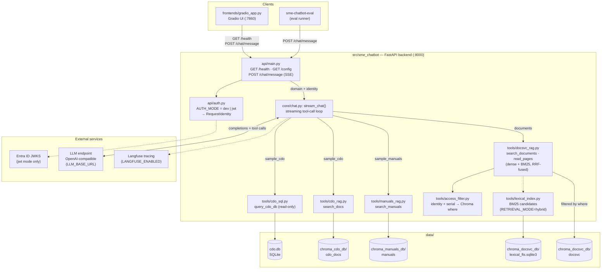
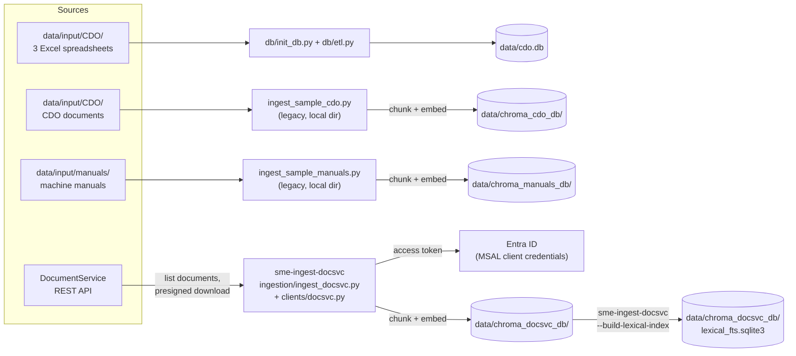

# SME Chatbot

A chatbot for a generic **SME** (Small and Medium Enterprise) answering
questions over three domains — CDO
(order confirmation) records, machine manuals, and the DocumentService
document library — through one FastAPI backend and a thin Gradio frontend.

See `AGENTS.md` for the full architecture/coding-conventions doc.

## Architecture

Two views of the system as it is today: the **runtime** path that answers a
chat message, and the **offline** pipelines that build the data stores the
runtime reads. Dashed edges are optional or mode-dependent.

### Runtime: answering a chat message



- The Gradio app has no imports from `sme_chatbot` — it only speaks HTTP/SSE
  to the backend, dogfooding the exact contract a future .NET portal proxy
  will consume (§4.1 of the plan doc). `GET /health` is always
  unauthenticated; `GET /config` and `POST /chat/message` go through
  `api/auth.py`.
- The request's `domain` picks the system prompt and toolset
  (`core/domains.py`); the LLM decides which of those tools to call, and the
  loop executes them and feeds the results back until the LLM answers.
- In the `documents` domain the caller's identity, plus the machine serial
  the conversation names (if exactly one), is turned into a Chroma `where`
  filter the LLM never sees. Keyword (BM25) hits are only candidate
  ids: they are re-fetched from Chroma under that same filter, so the
  lexical index is never the access gate.
- Embeddings are computed locally with `sentence-transformers`
  (`paraphrase-multilingual-MiniLM-L12-v2`), both at ingestion and at query
  time; only chat completions go to the remote LLM.

### Offline: building the data stores



`sme-ingest-docsvc` is the main pipeline. The two `ingest_sample_*.py`
scripts are for developers without DocumentService credentials, and
`scripts/import_sample_*.sh` can unpack pre-downloaded inputs into
`data/input/` (see [Quickstart](#quickstart)). The keyword index is rebuilt
from the chunks already in Chroma, with no DocumentService access and no
re-embedding.

## Quickstart

```bash
uv sync

# 1. Build the structured data (SQLite) — requires Excel files in data/input/CDO/
uv run python db/init_db.py
uv run python db/etl.py

# 2. Populate the "documents" domain from DocumentService (the happy path)
cp .env.example .env   # edit DOCSVC_* creds, plus LLM_BASE_URL / LLM_API_TOKEN / LLM_MODEL
uv run sme-ingest-docsvc --limit 5       # -> data/chroma_docsvc_db

# 3. Start the backend
uv run sme-chatbot-api                   # FastAPI on http://localhost:8000

# 4. Start the Gradio frontend (separate terminal)
uv run python frontends/gradio_app.py     # http://localhost:7860
```

`ingest_sample_cdo.py` and `ingest_sample_manuals.py` are optional, legacy
local-directory pipelines for developers who don't have valid
DocumentService credentials — they populate `data/chroma_cdo_db` and
`data/chroma_manuals_db` from local files instead:

```bash
uv run python ingest_sample_cdo.py        # -> data/chroma_cdo_db (needs data/input/CDO/)
uv run python ingest_sample_manuals.py    # -> data/chroma_manuals_db (needs data/input/manuals/)
```

Pre-downloaded sample data can be imported instead of running either ingestion
pipeline — see [`import_sample_cdo.sh`](#import_sample_cdosh)
and [`import_sample_manuals.sh`](#import_sample_manualssh)
below.

## Utility scripts

### [`analyze_chroma_db.py`](scripts/analyze_chroma_db.py)

Inspects a `chroma.sqlite3` file (any of the `data/chroma_*_db/` stores) and
writes a Markdown report: table row counts, collections/segments,
per-collection embedding-metadata distributions (category, language,
filenames, page/chunk stats), ingestion/sync lag between the metadata and
HNSW vector segments, full schema, and a Mermaid `erDiagram`. Opens the DB
read-only, so it's safe to run against a store an ingestion job is actively
writing to.

```bash
uv run python scripts/analyze_chroma_db.py \
    data/chroma_docsvc_db/chroma.sqlite3 \
    -o "data/chroma_docsvc_db/chroma_docsvc_report-$(date +%Y-%m-%d-%H%M%S)".md
```

### [`backup_data_folder.sh`](scripts/backup_data_folder.sh)

Archives the whole `data/` folder (SQLite DB, Chroma vector stores, source
Excel files) into a dated zip under `data/archive/`, named
`<date>-bk-chatbotv2-data-<hostname>.zip`. Skips `data/archive/` itself to
avoid nesting previous backups, and refuses to overwrite an existing archive
for the same day/host.

```bash
./scripts/backup_data_folder.sh
```

### [`import_sample_cdo.sh`](scripts/import_sample_cdo.sh)

Unzips a pre-downloaded `data/archive/sample-cdo.zip` archive (or the one
`ZIP_FILENAME` points to) into `data/input/`, populating it for `db/etl.py` /
`ingest_sample_cdo.py` without needing to source the Excel files individually.
Fails fast if the archive isn't there.

```bash
./scripts/import_sample_cdo.sh
```

### [`import_sample_manuals.sh`](scripts/import_sample_manuals.sh)

Unzips a pre-downloaded `data/archive/sample-manuals.zip` archive (or the one
`ZIP_FILENAME` points to) into `data/input/manuals/`, populating it for
`ingest_sample_manuals.py`. Fails fast if the archive isn't there.

```bash
./scripts/import_sample_manuals.sh
```

### [`publish-md-pdf.sh`](scripts/publish-md-pdf.sh)

Wrapper around the [`publish-md-pdf`](https://github.com/B-AROL-O/publish-md-pdf)
Docker image: renders one or more Markdown files to A4-sized PDFs. Mounts
each input file's parent directory plus the output directory into the
container, so no local Markdown-to-PDF toolchain is needed — only `docker`.
`--output-name` only applies when converting a single file.

```bash
./scripts/publish-md-pdf.sh \
    [--output-dir DIR] \
    [--output-name NAME] \
    <file.md> [file2.md ...]
```

## Environment variables

All variables (LLM, backend auth, Chroma collection paths, Gradio frontend,
DocumentService ingestion, eval, logging, log shipping) are documented in
[`.env.example`](.env.example) — copy it to `.env` and fill in real values.
`.env` is git-ignored; never commit it.

## Docker Compose

```bash
docker compose build
docker compose up          # chatbot-api on :8000, chatbot-gradio on :7860
```

Both services build from the same multi-stage, `uv`-based, CPU-only
`Dockerfile`; `chatbot-gradio` only overrides the run command. See
[`docs/procedures/docker-deployment.md`](docs/procedures/docker-deployment.md) for the full
walkthrough (build args, port conflicts, useful commands).

## Testing

```bash
uv run pytest tests/unit tests/backend_api -q   # new stack — no network/LLM/creds required
uv run pytest tests/ -v                         # everything, including read-only live-API contract suites
```

## Further reading

- [`AGENTS.md`](AGENTS.md) — architecture, data model, coding conventions (also `CLAUDE.md`, a symlink to it)
- [`docs/procedures/docker-deployment.md`](docs/procedures/docker-deployment.md) — Docker Compose deployment details
- [`docs/procedures/running-evals.md`](docs/procedures/running-evals.md) — Running the automated evals

<!-- EOF -->
